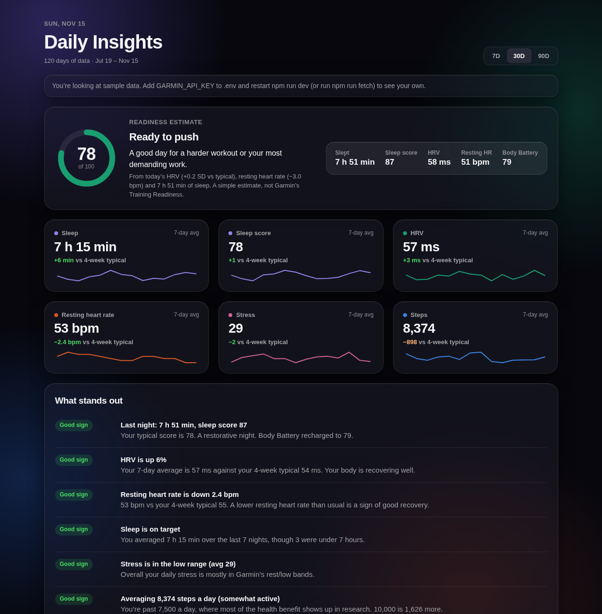
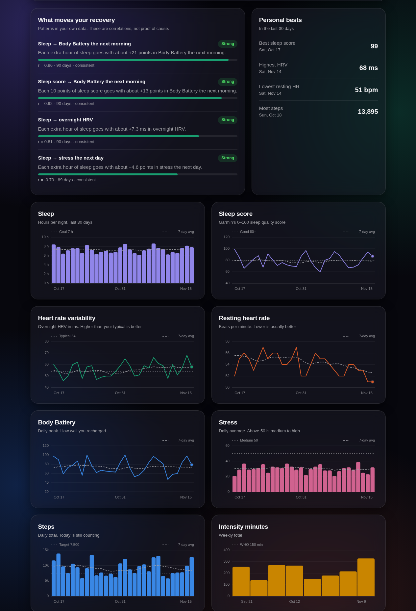

# Daily Insights: a private Garmin dashboard

A local dashboard for your Garmin health data. It turns sleep, HRV, resting heart rate, stress, Body Battery and steps into a daily readiness estimate, plain-language insights, and patterns from your own data. There's also an optional Grafana view.

It runs entirely on your computer. Your API key and health data never leave it, except to talk to Garmin.



## Features

- **Readiness estimate:** a daily score from last night's HRV, resting heart rate and sleep compared with your own baseline, plus a one-line "today's focus".
- **What stands out:** written insights (HRV trend, sleep consistency, stress, Body Battery recharge, steps, WHO intensity minutes), with things worth watching listed first.
- **Day by day:** a 14-day grid that colors each metric by how that day compared with your typical value.
- **What moves your recovery:** correlations found in your own data (for example "each extra hour of sleep ≈ +14 Body Battery"), each labeled with how much data supports it.
- **Charts:** sleep, sleep score, HRV, resting HR, Body Battery, stress, steps and intensity minutes, with 7-day trend lines. Plus personal bests and an activities summary.
- **Works with little data:** with fewer than 14 days, it compares your latest values with your history so far instead of showing blanks.
- **Auto-fetch:** `npm run dev` pulls fresh data from Garmin in the background and reloads the page when it arrives.
- **Grafana (optional):** a provisioned Grafana dashboard in Docker, also embedded in the page.
- **Glass design:** frosted-glass UI with light and dark themes, works on phones.



## Quick start

Requirements: [Node.js](https://nodejs.org) 18 or newer. Docker is only needed for the optional Grafana view.

```bash
git clone https://github.com/stalord63/garmin-dashboard.git
cd garmin-dashboard
npm install
npm run dev      # open the printed http://localhost:5173 link
```

Without a Garmin key it opens with **sample data** (clearly labeled), so you can try it right away.

## Connect your Garmin data

1. Create a Personal API key in Garmin Connect: https://connect.garmin.com/app/settings/personalApiToken
2. Copy the example settings file and add your key:
   ```bash
   cp .env.example .env
   # then edit .env:  GARMIN_API_KEY=your-key-here
   ```
   `.env` is gitignored. Never commit your key or paste it into code.
3. Run `npm run dev`. It fetches your last 90 days in the background and the page reloads with your data.

Other commands:

| Command | What it does |
|---|---|
| `npm run fetch` | Fetch fresh data now (writes `public/garmin.json`) |
| `GARMIN_DAYS=30 npm run fetch` | Fetch a different number of days |
| `GARMIN_SKIP_FETCH=1 npm run dev` | Start without fetching (e.g. offline) |
| `npm run build` | Production build into `dist/` |

You can also write `public/garmin.json` yourself in the format documented in `scripts/fetch-garmin.mjs`.

## Grafana (optional)

```bash
npm run grafana        # start Grafana at http://localhost:3000 (first start downloads the image)
npm run grafana:stop   # stop it
```

Grafana reads the same `public/garmin.json`. Once it's running, it also appears in the dashboard's **Grafana** section, following the 7D/30D/90D switch. Viewing needs no login. The admin login is `admin` / `admin` unless you set `GRAFANA_ADMIN_PASSWORD` in `.env` before the first start. Grafana is only reachable from your own computer.

## How it works

See **[architecture.md](architecture.md)** for the full picture: how the Garmin API is called, the data format, how baselines, readiness and patterns are calculated, the charts, the glass design and the Grafana setup.

```
Garmin API ──► scripts/fetch-garmin.mjs ──► public/garmin.json ──► React app (Vite)
                                                      └────────► Grafana (Docker, optional)
```

## About the numbers

- **Comparisons:** with 14+ days, tiles compare your last 7 days with the median of the 4 weeks before. With less, they compare your latest value with your typical value so far.
- **Readiness:** a simple heuristic from HRV, resting heart rate and sleep. It is not Garmin's Training Readiness.
- **Patterns:** these are correlations, not proof of cause.
- **Intensity minutes:** compared with the WHO guideline of 150 minutes of moderate activity per week.

**This is not medical advice.**

## Privacy

- **Your key stays out of the browser:** it is used only by a Node script on your machine.
- **Your health data stays local:** `public/garmin.json` and `dist/` are gitignored. Don't commit them.
- **No tracking:** there are no analytics and no external calls from the page. Grafana's usage reporting and update checks are turned off.

## Contributing

Issues and pull requests are welcome. Please don't include real health data or API keys in issues, screenshots or test files. Use the built-in sample data (`src/data/sample.js`) instead.

## License

[MIT](LICENSE)

Garmin, Garmin Connect and Body Battery are trademarks of Garmin Ltd. This project is not affiliated with or endorsed by Garmin.
