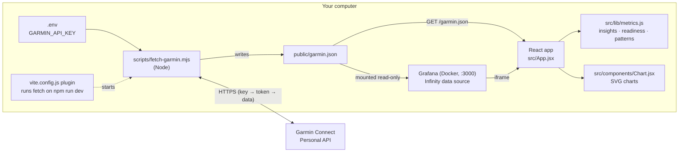
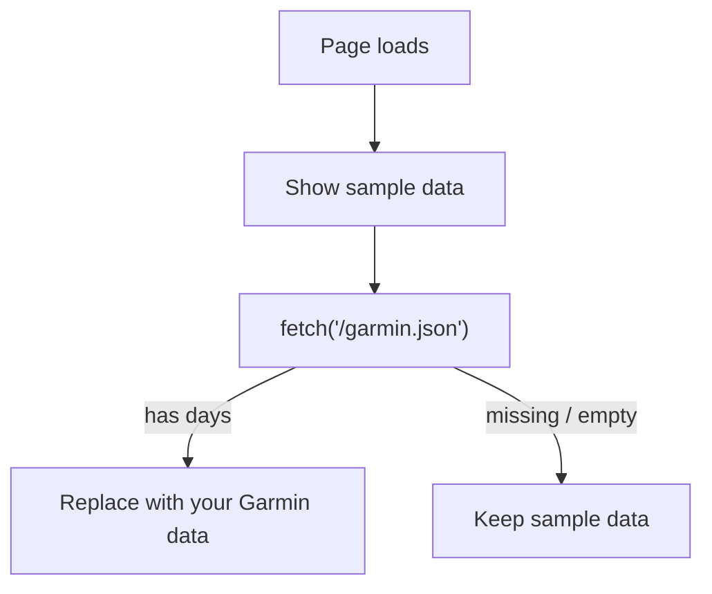

# Architecture

How the Garmin dashboard gets your data, turns it into insights, and draws the page.

## The big picture

There are two halves, connected by one JSON file:

1. **A Node script** (`scripts/fetch-garmin.mjs`) talks to the Garmin API on your machine and writes `public/garmin.json`.
2. **A React app** (Vite) reads that file in the browser, computes the insights, and renders the dashboard.

The browser never talks to Garmin and never sees your API key.



## File map

| File | Role |
|---|---|
| `scripts/fetch-garmin.mjs` | Downloads data from Garmin and writes `public/garmin.json`. Run with `npm run fetch`. |
| `vite.config.js` | Vite setup, plus a small plugin that runs the fetch script whenever `npm run dev` starts. |
| `public/garmin.json` | The data file the dashboard reads. Generated, personal; don't commit it. |
| `.env` | Holds `GARMIN_API_KEY`. Never shipped to the browser. |
| `src/main.jsx` | React entry point. Mounts `<App />`. |
| `src/App.jsx` | Loads data, holds UI state (chart range), lays out every section. |
| `src/lib/metrics.js` | All the math: baselines, readiness, insights, patterns, day grid, records. No React; pure functions. |
| `src/data/sample.js` | Generates 120 days of realistic fake data so the page works with no data at all. |
| `src/components/Chart.jsx` | Hand-written SVG line/bar chart with tooltip, reference line and 7-day trend line, plus `Spark` and `Ring`. |
| `src/styles.css` | Glass design: color tokens, light/dark themes, layout. |
| `src/components/GrafanaEmbed.jsx` | The Grafana section: checks Grafana is up, embeds the dashboard in an iframe. |
| `docker-compose.yml` | Runs Grafana locally (`npm run grafana`). |
| `grafana/provisioning/` | Grafana config loaded at startup: the Infinity data source and the dashboard folder. |
| `grafana/dashboards/garmin.json` | The "Garmin Health" Grafana dashboard. Generated by `grafana/generate-dashboard.py`. |

## 1. Getting the data (`scripts/fetch-garmin.mjs`)

### Authentication

Garmin's Personal API uses two credentials:

1. **API key** (long-lived; created at connect.garmin.com → Settings → Personal API Token). Read from `.env`, where a real environment variable overrides the file.
2. **Access token** (24 hours). The script trades the key for one on every run:

```
POST https://personal.connectapi.garmin.com/personalapitoken-service/personal-api/personal-api-key/token
Authorization: ApiKey <key>
→ plain-text token
```

Every data request then sends `Authorization: Bearer <token>`.

### What it downloads

The date range is the last 90 days (`GARMIN_DAYS` changes it), split into chunks of up to 30 days.

| Data | Endpoint | Calls |
|---|---|---|
| Steps, resting HR, stress, Body Battery, intensity minutes | `/usersummary-service/v2/dailysummaries?startDate&endDate` | 1 per chunk, in parallel |
| Overnight HRV | `/hrv-service/hrv/daily/{start}/{end}` | 1 per chunk, one after another |
| Sleep duration and score | `/sleep-service/sleep/dailySleep?date=` | 1 per day, max 4 at once (`pool()`) |
| Activities | `/activitylist-service/activities/search/activities?limit=200` | 1 |

HRV, sleep and activities fail softly (a warning, then carry on). A failed token request or daily-summary request stops the script, and the old `garmin.json` is left untouched.

### Transform

Raw Garmin responses are merged by date into a small, flat format:

```jsonc
{
  "days": [
    { "date": "2026-11-14", "steps": 9120, "sleepMin": 432, "sleepScore": 81, "hrv": 58,
      "restingHr": 52, "bodyBattery": 88, "stress": 27, "intensityMin": 45 }
  ],
  "activities": [
    { "date": "2026-11-14", "type": "Running", "durationMin": 42, "distanceKm": 7.4, "avgHr": 148, "calories": 510 }
  ]
}
```

- Any value that is missing or not a number becomes `null`.
- Units: seconds → minutes, meters → km. Body Battery is the day's peak. Negative stress (Garmin's "not enough data") becomes `null`.
- `intensityMin` = moderate + 2 × vigorous, Garmin's weighted count.
- Garmin dates a night's sleep by the **morning you wake up**, so `sleepMin` on 14 Nov is the night of 13→14 Nov.

This format is the contract between the two halves. Anything that writes it to `public/garmin.json` (the script, or a file you make by hand) works with the app.

### Auto-fetch on `npm run dev`

`vite.config.js` registers a plugin (`garminFetchOnStart`) that runs only in dev mode:

1. When the dev server starts listening, it spawns `node scripts/fetch-garmin.mjs` in the background, so the server is ready immediately.
2. The script's output is relayed to the terminal with a `[garmin]` prefix.
3. On success it sends Vite's `full-reload` message over the dev WebSocket, so any open tab reloads with the new data.
4. On failure it logs a warning and the page keeps the last saved file.

`GARMIN_SKIP_FETCH=1 npm run dev` turns this off.

## 2. Loading data in the browser (`src/App.jsx`)

The app picks its data like this:



- `garmin.json` is requested with `cache: 'no-store'`, so a reload always gets the latest file.
- Sample data is never mixed with real data: if `garmin.json` has no activities, the Activities section says so instead of showing fake ones.
- `data.source` records where the data came from (`sample` or `api`), which drives the banner and footer.
- There is no file import. On load, the app also deletes a leftover `garmin-dashboard-data` entry that an older version stored in `localStorage`.

## 3. Turning numbers into insights (`src/lib/metrics.js`)

All functions take the sorted `days` array (and sometimes `activities`) and return plain objects. React just renders them.

### Baselines: "compared with your typical"

`windowStats(days, key)` adapts to how much history you have:

| History | "Now" | "Typical" |
|---|---|---|
| 14+ days | average of the last 7 days | median of the 4 weeks before them |
| under 14 days | latest value | median of all earlier days (needs 3+) |

A **median** is used rather than a mean so one odd day (for example the day the watch was set up) can't distort the baseline.

**Partial today:** steps, stress and intensity minutes for today are still accumulating, so `completeDays()` leaves today out of their comparisons, grid colors and patterns.

### Readiness estimate

`readiness(days)` builds a simple 1–100 score. It's a heuristic, not Garmin's Training Readiness:

```
score = 60
      + 12 × (today's HRV − typical HRV) / max(SD of HRV, 3)
      −  3 × (today's resting HR − typical resting HR)
      +  8 × (last night's sleep hours − 7)
```

The score is clamped to 1–100. 70+ is "Ready to push", 45–69 "Steady", below 45 "Take it easy", and each label comes with a one-line focus tip.

### "What stands out"

`insights()` runs a series of rules and returns `{ tone, title, detail }` items, sorted watch → good → note:

- **Short history:** a "Building your baseline" note when there are fewer than 14 days.
- **Last night:** sleep score bands (80+ good, 60–79 fair, below 60 poor).
- **HRV vs typical:** a 5% dead band. **Resting HR vs typical:** flagged at ±2 bpm.
- **Sleep:** 7-night average vs 7 hours; a spread over ±45 min is flagged as inconsistent.
- **Stress:** Garmin's bands (0–25 rest, 26–50 low, 51–75 medium, 76–100 high).
- **Body Battery:** days whose peak stayed under 60.
- **Steps:** activity bands (<5,000 sedentary, <7,500 low, <10,000 somewhat, 10,000+ active).
- **Intensity minutes:** vs the WHO 150 min/week guideline.
- **With more data:** sleep → HRV payoff (60 days), most and least active weekday (28+ days), training-time change (activities).

### "What moves your recovery"

`drivers(days)` checks a fixed list of plausible cause → effect pairs and computes the Pearson correlation for each:

- Sleep → next-morning Body Battery, overnight HRV, next-day stress
- Sleep score → Body Battery
- Daytime stress → that night's sleep score, HRV, next resting HR
- Steps → that night's sleep score
- Intensity minutes → that night's HRV

The cause and effect can be offset by a day (`lag: 1`, e.g. yesterday's stress vs last night's sleep). A pair is shown only with enough data (6+ days) and a strong enough correlation (|r| ≥ 0.5 below 14 days, ≥ 0.35 after). The slope is turned into plain language ("each extra hour of sleep ≈ +14 Body Battery"), and every pair carries its own confidence label (early signal / building / consistent). These are correlations, not proof of cause.

### Other outputs

- `dayGrid(days, 14)`: for each metric and day, how many standard deviations from your median, flipped so positive always means "better" (lower is better for resting HR and stress). The UI colors cells by this.
- `rolling(days, key)`: trailing 7-day average for the dashed trend lines; shown once there are 14+ days.
- `records(days)`, `weekly(days, key)`, `activitySummary(...)`: personal bests, weekly totals, per-sport totals.
- `METRICS`: one table of label, direction (higher or lower is better), formatting and units per metric. Adding a metric starts here.

## 4. Drawing the page

### Layout (`App.jsx`)

Top to bottom: header and range switch (7D / 30D / 90D) → readiness card → 6 metric tiles → What stands out → Day by day grid → What moves your recovery + Personal bests → 8 charts → Grafana → Activities → Daily data table (collapsible).

The range switch only affects charts, records and the table. Tiles, insights and patterns always use the full history so their baselines stay stable.

### Charts (`Chart.jsx`)

No chart library, just SVG:

- `ResizeObserver` keeps the width responsive.
- "Nice" axis ticks.
- Rounded bars or a line with gaps for missing days.
- An optional dashed reference line (goal or typical) and dashed 7-day trend line.
- A hover and keyboard (← →) tooltip.
- `Spark` is the mini line in each tile; `Ring` is the readiness gauge.

### Glass design (`styles.css`)

- **Color field:** a fixed `body::before` layer of four soft radial gradients (`--blob-1…4`) sits behind everything.
- **Glass surfaces** (`.card`, `.banner`, `.segmented`, `.ghost`): translucent `--glass` fill, `backdrop-filter: blur(24px) saturate(170%)`, a hairline light border (`--glass-border`), a soft drop shadow and an inner top highlight (`--glass-hi`).
- **Themes:** all colors are CSS variables on `:root`, redefined under `prefers-color-scheme: dark`.
- **Fallback:** browsers without `backdrop-filter` get a more opaque fill via `@supports not (...)`, so text stays readable.
- **Responsive:** breakpoints at 1000, 900 and 520 px. On phones, the day grid scrolls sideways inside its card and opens scrolled to the newest day.

## 5. Grafana

An optional second view of the same data, running locally in Docker.

### How Grafana gets the data

Docker Desktop runs containers in a VM, so Grafana can't reliably reach the Vite dev server. Instead:

1. `docker-compose.yml` mounts `public/` **read-only** into Grafana's own static folder (`/usr/share/grafana/public/garmin`).
2. Grafana itself serves the file at `http://localhost:3000/public/garmin/garmin.json`.
3. The **Infinity** data source (plugin `yesoreyeram-infinity-datasource`) fetches that URL. Its `allowedHosts` permits only `http://localhost:3000`.
4. Each panel's query picks the `days` (or `activities`) array, parses `date` as a timestamp and reads one or more numeric fields.

As a result, Grafana always shows whatever the last fetch wrote, even when `npm run dev` isn't running. Like the React app, it only sees the history in `garmin.json` (90 days by default).

### Setup is all files (provisioning)

Nothing is configured by clicking:

- **`grafana/provisioning/datasources/garmin.yml`:** creates the "Garmin JSON" data source (uid `garmin-json`).
- **`grafana/provisioning/dashboards/garmin.yml`:** loads every dashboard in `grafana/dashboards/`, re-checked every 30 s.
- **`grafana/dashboards/garmin.json`:** the dashboard (uid `garmin-health`), also set as Grafana's home page. It contains 6 stat tiles, 6 time series (sleep in hours with a 7 h line, sleep score, HRV + resting HR on two axes, Body Battery + stress, steps, intensity minutes) and an activities table.
- **`grafana/generate-dashboard.py`:** writes that JSON. To change panels, edit the script and run `python3 grafana/generate-dashboard.py grafana/dashboards/garmin.json`.

Versions are pinned: Grafana `12.4.3`. The Infinity plugin is installed at startup (`GF_PLUGINS_PREINSTALL_SYNC`); its 4.x versions need Grafana 12.2.5+ or 11.6.11+.

### Embedding in the React page

- Grafana runs with **anonymous Viewer** access and **embedding allowed**, so the page can show it in an iframe without a login. The admin login is `admin` / `GRAFANA_ADMIN_PASSWORD` (default `admin`).
- `GrafanaEmbed.jsx` first checks Grafana is running with a `no-cors` request to `/api/health`. Grafana sends no CORS headers, but an opaque response still proves the server answered.
- The iframe URL follows the page: `from=now-{7|30|90}d` from the range switch, `theme=dark|light` from the system theme, and `kiosk` to hide Grafana's menus.
- If Grafana is down, the section shows how to start it and a Retry button.
- Use `VITE_GRAFANA_URL` in `.env` to point it at a different Grafana.

### Safety

- **Local only:** the port is bound to `127.0.0.1:3000`, so other devices on your network can't open it.
- **Read-only data:** `public/` is mounted read-only, so Grafana can't change your data.
- **Off by default:** Grafana runs only after you start it with `npm run grafana`.

## 6. Common tasks

| I want to… | Do this |
|---|---|
| Refresh data | Restart `npm run dev`, or run `npm run fetch` and reload the page |
| Start offline | `GARMIN_SKIP_FETCH=1 npm run dev` |
| Pull more history | `GARMIN_DAYS=180 npm run fetch` |
| Add a new metric | 1) map it in `fetchFromGarmin()` into each day object; 2) add it to `METRICS` in `metrics.js`; 3) optionally add a tile, chart, grid row (`GRID_KEYS`) or driver pair (`PAIRS`) |
| Add a new insight rule | Push a `{ tone, title, detail }` object in `insights()` |
| Start / stop Grafana | `npm run grafana` / `npm run grafana:stop` (logs: `npm run grafana:logs`) |
| Change Grafana panels | Edit `grafana/generate-dashboard.py`, regenerate the JSON; Grafana reloads it within 30 s |
| Change the look | Edit the tokens at the top of `styles.css` (`--glass`, `--blob-*`, metric colors) |

## Privacy

- **Your key stays out of the browser:** it lives only in `.env` and is used only by the Node script.
- **Garmin is the only outside service for your data:** the browser loads data only from your local dev server and your local Grafana. Grafana's first start also downloads its image and the Infinity plugin, and update checks and usage reporting are turned off.
- `public/garmin.json` (and the copy in `dist/` after a build) contains personal health data, so keep both out of version control.
